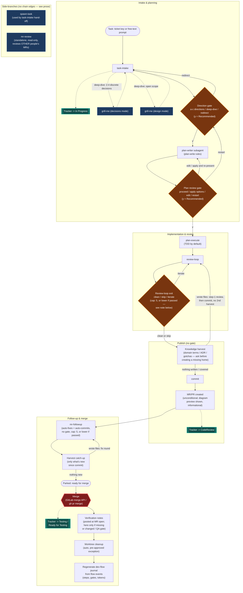

# simo-dev

Personal end-to-end dev flow plugin for Claude Code: intake, review-loop, commit, MR follow-up.

This README is the entry point — what the plugin does and how its skills chain together. For full operational detail (issue-tracker auto-transitions, model strategy, code-review severity table, dev-flow journal, install/maintenance ritual) see [`docs/canonical-flow.md`](docs/canonical-flow.md).

## Installation

### Install from GitHub

The plugin is published at [`github.com/simopala82/simo-dev`](https://github.com/simopala82/simo-dev).
The repo is its own marketplace, so two commands in a Claude Code session are enough:

```
/plugin marketplace add simopala82/simo-dev
/plugin install simo-dev@simo-dev-marketplace
```

Then restart Claude Code (or run `/reload-plugins`) so the skills load, and check that
`/plugin` lists `simo-dev`. Optional next steps:

- `/simo-dev:model-strategy` — pick which model backs each of the plugin's subagents.
- `/simo-dev:onboard-repo` — run it in a session opened in the target repo's own folder: it
  sets up that repo's conventions (CLAUDE.md "Agent skills" section, issue tracker, domain docs).

To get a new version later, refresh the marketplace, update the plugin, then restart Claude Code:

```
claude plugin marketplace update simo-dev-marketplace
claude plugin update simo-dev@simo-dev-marketplace
```

Releases and their notes: [GitHub Releases](https://github.com/simopala82/simo-dev/releases).

### Or ask Claude Code to do it

Open a session (in any repo) and ask Claude Code to install this plugin from
`github.com/simopala82/simo-dev`. It runs the commands above for you and can confirm the
marketplace registered and the plugin loaded.

For example:

> Install the plugin https://github.com/simopala82/simo-dev and set it up with
> `/simo-dev:model-strategy`.

### Prerequisites

- **Claude Code CLI**, not just the Claude Desktop app. `/plugin marketplace add` and
  `/plugin install` (used below) are Claude Code CLI-only — the Desktop app has a separate,
  different plugin-browser UI that does not support these commands. Install the CLI with the
  native installer (no Node.js required):
  - Windows (PowerShell): `irm https://claude.ai/install.ps1 | iex`
  - macOS / Linux: `curl -fsSL https://claude.ai/install.sh | bash`
- **git**, reachable from the same shell — needed to clone the marketplace source. The repo is
  public and cloned over HTTPS, so no GitHub account or SSH key is needed.

Once installed, the skills themselves need:

- **Python 3** — required, near-universal across skill bodies: almost every skill's `lib/*.py`
  helpers run through it.
- **`glab` or `gh`** — one of the two, whichever matches the forge (GitLab or GitHub) your own
  projects are on, not both.

### After installing: the plugin's "eager" behavior needs your own CLAUDE.md

The flow is opt-in: dormant until you run `simo-dev:task-intake`, which writes a session flag and
a worktree marker (`lib/flow_state.py`). Run it on a checkout with work already in progress
(changes, local commits, a plan, an open MR/PR) and it offers to re-enter the flow at
`review-loop`, `plan-execute` or `mr-followup` instead of a full intake. Its eager behaviors — automatic `review-loop` before
commit/push/merge, PR auto-fix — apply only while the flow is active, and depend on rule text that must live in **your own**
global `CLAUDE.md`, not in the plugin package. Claude Code has no "load this every turn" hook
for skill content, so these rules are referenced from the plugin, not shipped inside it. The
checklist of headings your `CLAUDE.md` needs, and the actual rule text to paste in, follow
directly below. Also not bundled: an `Explore` subagent definition (`~/.claude/agents/Explore.md`).

#### What to paste into your CLAUDE.md

1. **Required headings.** Your own `CLAUDE.md` needs rule text under (or clearly matching) each
   of these headings: `Explicit entry`, `Worktrees`, `Worktree cwd gotcha`, `Repo name from a
   worktree`. This list isn't guaranteed exhaustive — grep the plugin source for `CLAUDE.md` and
   fold in any newly-referenced heading before trusting it as complete.
2. **Three more rules with no heading to grep for.** They're referenced in the plugin only as
   prose, so a heading search won't find them: the review-loop trigger rule (full text below),
   the spawn `cwd` rule, and the merge / force-push permission gates. Locate and copy the last two
   from wherever your own conventions already state them, or write them fresh — the review-loop
   trigger rule text is given in full right here.
3. **The review-loop trigger rule** — paste this into your own `CLAUDE.md`, not into a plugin
   file: Claude Code loads a global `CLAUDE.md` on every turn, but a skill body only loads when
   that skill is invoked, so this rule has to live in `CLAUDE.md` to actually fire eagerly.

   > **Review-loop eager** (only while the simo-dev flow is active): when a trigger fires and review-loop hasn't run since the last batch
   > of edits, **auto-invoke `simo-dev:review-loop` and proceed** — never ask first. Triggers:
   > - **Linguistic** — "done" / "ok" / "proceed" / "merge" / "push" / "ship it" / "let's commit".
   > - **Implementation** — tests passing, feature complete, batch of edits done.
   > - **Structural** — BEFORE `git commit`, `git push`, `git merge`, `glab mr merge`,
   >   `glab api …/merge`, `gh pr merge`, or `simo-dev:commit`. A PreToolUse hook on `Bash` self-gates to `git commit`
   >   (any form, including `git -C <worktree> commit` and chained `add && commit`) and injects a
   >   reminder pointing to `simo-dev:guide`. Outside the flow it prints only a one-line
   >   `simo-dev advisory: no review recorded` on a feature-branch commit or push.
   >
   > Inside a `simo-dev:mr-followup` run nothing the run does is a trigger: its edits, test runs,
   > commits, pushes, and the user's answers to its own questions. Any other review-loop waits as
   > simo-dev `docs/canonical-flow.md` "In-scope improvements" (Transparency) and
   > `simo-dev:mr-followup` "No Also-fixed ledger work inside a run" describe.
   >
   > Skip only when clearly useless: trivial doc/typo edit, empty diff, or a review already covers
   > the pending files (`simo-dev:commit` step 1 checks this deterministically — no TTL). A clean
   > run cascades into `simo-dev:commit` (review-loop step 8 exceptions apply); unresolved
   > findings still gate. A clean run lets the next `simo-dev:commit` skip its review pre-flight,
   > until a file changes again.
4. **The In-scope improvement rule** — paste this into your own `CLAUDE.md` too: it must be
   always-on, and it also governs edits made outside any skill, where no skill body is loaded.

   > **In-scope improvements**: a change touching only files already in the task's diff or plan is
   > done in the same task and declared under "Also fixed" — never spawned as a follow-up. Ask first
   > when it needs a decision or would swell the diff noticeably. Dead code in a file in the diff is
   > deleted when `rg -uu` finds no other use, asked about when search can't verify it, and only
   > mentioned outside the diff. An ad-hoc one made in the flow, when a branch-point check run
   > before the edit finds its lines all pre-existing, is recorded in the Also-fixed ledger as
   > soon as it is made, or no commit message or MR body declares it. No ad-hoc edit is
   > made during a `simo-dev:mr-followup` run: let the run stop at a round boundary, then make
   > it and commit through `simo-dev:commit` (not `--no-mr`). Detail:
   > `docs/canonical-flow.md` "In-scope improvements".
5. **Personal identity stays yours.** Tracker user and git author name belong in your own
   `CLAUDE.md` too, but they aren't part of this checklist — set them to your own values, there's
   nothing to copy from the plugin.
6. For everything else, see [`docs/canonical-flow.md`](docs/canonical-flow.md).

## Plugin layout

- `.claude-plugin/plugin.json` — manifest (name, version, skills dir)
- `.claude-plugin/marketplace.json` — self-hosting marketplace manifest, lets this repo be added
  directly as a Claude Code marketplace (see Installation → Install from GitHub above)
- `docs/canonical-flow.md` — full operational detail (see above)
- `hooks/` — `PreToolUse`/`PostToolUse` hooks (review-loop staleness marker, skill-invocation logger that also writes the task's flow events, push reminder)
- `lib/` — shared Python helpers used across skills (issue-tracker transitions, repo identity, MR presentation, etc.), plus `lib/flow_dashboard.py`, a local HTML dashboard of the flow events (status of each task, running, stale or done, then timeline and tokens per task, and the sessions that ran simo-dev skills without a task as untracked runs; see `docs/canonical-flow.md` "Dev-flow journal & knowledge harvest"), and `lib/step_replay.py`, which replays one flow step on a frozen input to compare plugin variants by cost and outcome (see `docs/step-replay.md`)
- `skills/*/SKILL.md` — one directory per skill (see reference table below)

To modify this plugin's source and have Claude Code pick up the change, bump the version in
`.claude-plugin/plugin.json` and follow the release ritual — documented in `docs/plugin-release.md`
in the `simo-scripts` monorepo where this plugin's source lives — editing the source alone does not
apply changes, Claude Code runs a materialized cache copy.

## The simo-dev flow

### Canonical chain

The straight-line path from a task to a merged, verified change, grouped into its four canonical-chain phases. The side-branches panel is deliberately drawn with no edges into the chain — their exact attachment points are prose, not arrows (see the sections below the diagram):



### Gates: hard vs. soft

Only **3 gates always require explicit human confirmation** — never auto-answered:

1. **The merge itself** (`glab mr merge`, the GitLab merge API `glab api -X PUT …/merge`, `gh pr merge`) — always the user's call: run by hand, or by `mr-followup merge` (a fresh session started from its merge card) only after the user's explicit `y` at its merge gate.
2. **Force-push** — always forbidden without explicit ask.
3. **Commit+push on a protected branch** (`master`/`main`/`develop` — out-of-flow fallback, the canonical flow always works in a worktree) — the single gate of `commit`'s Protected-Branch Path; nothing skips it.

MR creation (in `commit`) and commit-fixes (in `mr-followup`) used to have their own gates too, but both are unconditional now — verification is delegated entirely to the pipeline + review-comment loop that runs after every push. A pre-push MR-state guard (`lib/check_mr_state.py`) runs before every push, first one included: if the branch's MR was merged/closed mid-session, the push is stopped (not just warned) so the deleted branch isn't silently recreated as an orphan — the same stop now also fires when the guard itself couldn't determine the MR state (glab/gh missing, bad token, network down), instead of assuming it's safe to push.

Every other checkpoint (direction, plan review, review-loop exit; a decided brief skips the direction gate, see `docs/canonical-flow.md` "Decided brief") has a documented default answer — you're asked each time interactively, and the default is the recommended option.

**QA/PROD verification happens at release time, not here.** commit leaves a "Verification notes (auto)" comment on the ticket when it opens the MR, and mr-followup posts a superseding one when later commits or a passing pre-merge QA gate change it; the release skill's per-ticket verify step reads it after each deploy, runs the behavior check, and transitions the ticket (`Ready for Deploy` after QA, `Done` after prod) behind its own single confirmation.

**Diagram legend:**

- **Red, solid heavy border** — hard gate: always asks, never auto-answered.
- **Amber, dashed border** — soft gate: asks interactively, each with a documented default answer.
- **Blue, dashed border** — side-branch skill, not on the canonical chain.
- **Teal, subroutine (double-bar) shape** — issue-tracker ticket transition: a side-effect of the step it branches from, not a flow step itself.

Two flow details not drawn in the diagram: in prompt mode (no ticket key), `task-intake` asks whether to create a ticket mid-flow (default: no); and `grill-me` captures crystallized domain terms into `CONTEXT.md` / `docs/adr/` inline, as it goes. The diagram's `HARVEST` node in `commit` now runs the full three-question harvest (domain terms, ADRs, gotchas — not just domain terms), before commit's review pre-flight, so anything it writes goes back through `review-loop`; `HARVEST2` writes go back through an `mr-followup` review round the same way — it shares one ask-before-create-if-missing gate with `grill-me`'s inline capture on first use per repo (`skills/commit/lib/knowledge-harvest.md`).

### Side-branches

- **`grill-me`** — one-question-per-turn interview to resolve discrete open decisions; reached explicitly or via `task-intake`'s `deep-dive` escalation, then hands back to the direction gate; run on its own, it ends by pointing to `task-intake` with its decisions or spec.
- **`mr-review`** — fully standalone, read-only review of *someone else's* MR/PR. Never writes to GitLab/GitHub, never touches the issue tracker, not part of the chain.
- **`spawn-task`** — generic background-session spawn wrapper, used by `task-intake`'s hand-off (and available on demand); writes the decided-brief block when a follow-up's direction is already decided.
- **`onboard-repo`** — detects and scaffolds simo-dev's per-repo conventions (CLAUDE.md's Agent skills section, issue tracker, domain docs) in a target repo; a standalone utility like `spawn-task`.
- **`model-strategy`** — view/change which model backs each of the plugin's own `Agent` dispatch points (`code_review`, `plan_critique`, `explore_research`, `plan_execute`); a standalone utility, same class as `onboard-repo`. See "Model strategy" in [`docs/canonical-flow.md`](docs/canonical-flow.md).

## Skill reference

| Skill | Purpose | Trigger | Hands off to |
|---|---|---|---|
| `task-intake` | Turn a ticket key or free-text prompt into a reviewed plan + worktree + hand-off (fast path on a decided brief, `lib/fast-path.md`) | Start of any non-trivial task | `plan-execute` |
| `review-loop` | Iterative code review + auto-fix before commit | After implementation; also auto-invoked proactively | `commit` |
| `commit` | The only sanctioned way to commit — cascades review-loop → commit → push → MR | Any "commit" phrase | `mr-followup` |
| `mr-followup` | Post-push pipeline + review-comment monitoring, auto-fix, post-merge cleanup + journal regenerated from flow events | After a push | terminal step |
| `afk` | Unattended driver overlaying the canonical chain | "afk" / unattended request | same chain, gate-free |
| `grill-me` | Interview to resolve open decisions (decisions mode) or produce an approved design spec (design mode) | Explicit request, or `task-intake` deep-dive | back to `task-intake` |
| `mr-review` | Read-only critical review of someone else's MR/PR | "review MR \<link\>" | none (standalone) |
| `spawn-task` | Wraps background-session spawning with inferred title/prompt/background | "spawn this", or invoked internally by other skills | none (utility) |
| `guide` | Flow conventions: the chain, gate rules, ticket marker, publish path | On demand — worktree policy and the other eager rules live in the installer's `CLAUDE.md` | none (reference doc) |
| `onboard-repo` | Detects and scaffolds simo-dev's per-repo conventions (CLAUDE.md Agent skills section, issue tracker, domain docs) in a target repo | "onboard this repo" | none (utility) |
| `model-strategy` | View/change which model backs `code_review`, `plan_critique`, `explore_research`, `plan_execute` dispatch | "model strategy" | none (utility) |

Bundled discipline skills (invoked by the chain, no external plugin needed): `plan-write`, `plan-execute`, `tdd`, `debug`, `verify-done`, `code-review-protocol`, plus the `code-reviewer`, `plan-reviewer`, `plan-writer` and `plan-executor` agents (`plan-write` is the `plan-writer` subagent's rules, not a standalone step).

## License

MIT — see [`LICENSE`](LICENSE).

## Further reading

- [`docs/canonical-flow.md`](docs/canonical-flow.md) — full detail: issue-tracker auto-transitions and how to configure one, model strategy, code-review severity table, dev-flow journal
- In the `simo-scripts` monorepo (where this plugin's source lives) — `docs/plugin-release.md`: how to release a change to this or any local plugin (version bump, cache resync, restart)
- In the `simo-scripts` monorepo — `docs/agents/domain.md`, `docs/agents/issue-tracker.md`, `docs/agents/triage-labels.md`: repo-level conventions the skills expect to be followed
- [`CONTRIBUTING.md`](CONTRIBUTING.md) — how to propose a change, run tests locally, and why there's no CI yet
